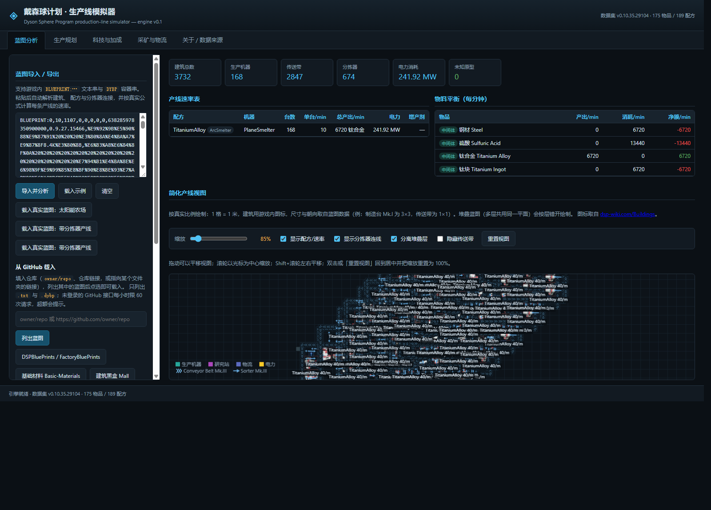

# 戴森球计划 · 生产线模拟器

**网页版《Dyson Sphere Program》生产线模拟器。** 读取游戏导出的蓝图串，算出真实的生产速率、物料平衡与电力；也能把蓝图重新导出成游戏可用的字符串。

纯 TypeScript 引擎，无框架依赖；界面是 Vite + 原生 DOM。



---

## 这是什么

把游戏里的蓝图粘进来，它会：

1. **解码**蓝图串（支持游戏历史上出现过的三种记录格式，见下）；
2. **还原**每条产线的机器、配方、分拣器、传送带与物流；
3. **按游戏公式**算出速率、物料平衡、电力与增产剂消耗；
4. **画**一张按真实比例（1 格 = 1 世界单位）的简化产线图；
5. **导出**回游戏可用的蓝图串。

上面那张图是一份 3732 栋建筑的真实蓝图：168 台位面熔炉产 **6720 钛合金/分钟**，
消耗 6720 钢材与 13440 硫酸，**241.92 MW** —— 与配方逐项吻合。

---

## 功能

| 页面 | 内容 |
|---|---|
| **蓝图分析** | 导入/导出蓝图、速率表、物料平衡、Canvas 产线图、GitHub 蓝图库直连 |
| **生产规划** | 反向规划：要 N/分钟产物 → 需要多少机器、多少原料、多少电 |
| **科技与加成** | 108 项科技、36 项可重复升级对生产的影响 |
| **采矿与物流** | 矿脉产出、矿机耗电、采集加成、带子吞吐 |
| **关于 / 数据来源** | 数据集版本、来源与冲突登记 |

产线图交互：拖动平移、滚轮以光标为中心缩放、等级配色、隐藏传送带、分离堆叠层、重置视图。

---

## 快速开始

```bash
pnpm install
pnpm dev        # 开发服务器
pnpm test       # 243 项测试
pnpm build      # 类型检查 + 生产构建
```

### 可选：拉取本地资源

仓库**不包含**第三方素材，全新克隆后按需拉取：

```bash
pnpm corpus:fetch   # 第三方蓝图语料（约 1 MB），启用 6 项依赖语料的校验
pnpm icons:fetch    # 63 个建筑图标（来自 dsp-wiki.com）
```

没拉也不会坏：`corpus` 相关的校验与测试会**明确跳过**，图标则回退成**彩色方块**。

页面上可直接载入三份内置真实蓝图（或用链接参数 `?tab=blueprint&real=smelter-v1.txt`）：

| 样本 | 规模 | 看点 |
|---|---|---|
| `solar-farm-v1.txt` | 8687 栋 | 16 层堆叠太阳能 |
| `factory-v2.txt` | 2971 栋 | 1195 个分拣器，v2 记录格式 |
| `smelter-v1.txt` | 3732 栋 | **168 台熔炉，唯一能看到速率表的样本** |

---

## 真实蓝图兼容性

游戏历史上换过记录格式，本项目的解码器**三种都支持**：

| body | 记录框架 | 状态 |
|---|---|---|
| v2 | `pathNumber` 判别符（`-102`） | 已支持，写入器与游戏输出**逐字节一致** |
| v1 定长 | 61 字节定长记录 | 已支持 |
| v1 变长 | `41 + 4n` | 已支持 |

**社区语料 28/28 全部可解码，累计 44,846 栋建筑**（含 9,123 条传送带、3,232 个分拣器）；
语料一致性检查：**悬空引用 0、区域越界 0**。

### 一个值得单独说的发现：v1 的配方藏在尾部数组里

v1 记录**没有 `recipeId` 字段** —— 它的头部只有位置、朝向和原型 id。所以配方的唯一去处是
尾部那个 i32 数组，而它**不是有意义的整数数组，是按字节紧密排列的**：
配方在**字节偏移 14** 的 `i16`。

> **陷阱**：把这四个字节当 `float` 读会得到 **32.0 / 8.0 / 0.03125** —— 看起来完全像某个倍率系数。
> 而按 `i16` 读是 **66 / 65 / 61**，正是 TitaniumAlloy / TitaniumIngot / DiamondAdvanced，
> 也就是那三个蓝本文件名。

解出后，27/28 个原本算不出速率的真实蓝图**现在能算了**。

---

## 数据与准确性

**所有游戏数值都在 `src/engine/data/`，改数值不需要动引擎。**

| 文件 | 内容 | 来源 |
|---|---|---|
| `dsp-vanilla.json` | 175 物品 / 189 配方 / 66 建筑 / 108 科技 / 36 升级 | [dsp-wiki.com](https://dsp-wiki.com/) `Module:GameData` |
| `building-icons.json` | 建筑图标清单（61/66 覆盖；图片需 `pnpm icons:fetch`） | dsp-wiki.com |
| `building-slots.json` | 33 个建筑的连接槽位 | **从游戏本体资源提取** |

### 交叉验证

每个关键数字都尽量有两个独立来源，并把结论写成可复现的校验脚本：

| 结论 | 验证方式 |
|---|---|
| 建筑常数（速度、耗电、倍率） | 对齐游戏 `PrefabDesc` 字段 |
| 配方解码 | 两份语料 **100%** 命中，与 `recipe.facility` 一致，**0 未知 id** |
| 槽位数量 | 与游戏资源独立提取的结果 **21/21** 吻合 |
| 分拣器臂几何 | 4427 个分拣器实测，**96%** 落在 1–3 格 |
| 传送带方向 | 用真实连接图当基准，吻合度 **0.9951** |
| 蓝图写入器 | 与游戏导出**逐字节相同**（头部+区域 43 B、建筑记录 2109 B） |

**不隐藏冲突**：来源不一致时写入 `conflict` 字段并在文档登记，不静默取值。

---

## 项目结构

```
src/engine/       纯 TS 引擎（无 DOM，可在 Node 直接跑）
  types.ts        数据模型与常量
  registry.ts     索引、查找、数据集自检
  production.ts   生产数学（速率 / 电力 / 增产剂）
  rules.ts        科技加成聚合、增产剂规则、采集公式
  planner.ts      反向生产规划
  factory.ts      蓝图 → 工厂模型（产线 / 连接 / 物料平衡）
  bp/             蓝图编解码（MD5F + gzip + DYBP）
  data/           静态数据集
src/ui/           Vite + 原生 DOM 界面
test/             23 个文件 / 243 项测试
tools/            数据集构建、逆向探针、校验脚本
docs/             技术参考文档
```

---

## 文档

| 文档 | 内容 |
|---|---|
| [BLUEPRINT-FORMAT.md](docs/BLUEPRINT-FORMAT.md) | 蓝图串字节级格式、MD5F 变体、v1 尾部数组的字段含义 |
| [GAME-DATA.md](docs/GAME-DATA.md) | 全部公式与常数、来源、已登记的来源冲突 |
| [BUILDING-CONNECTIONS.md](docs/BUILDING-CONNECTIONS.md) | 逐建筑连接点清单、记录字段的权威顺序 |
| [BUILDING-SLOTS.md](docs/BUILDING-SLOTS.md) | 连接槽位的提取、交叉验证，以及**一次失败的标定** |
| [UNITY-ASSETS.md](docs/UNITY-ASSETS.md) | 如何从游戏 Unity 资源里取出槽位数据 |

开发过程中的踩坑与纠错记录不随仓库发布。

---

## 已知限制

- **蓝图视图是简化重绘**：按真实坐标布局并计算速率，但不是逐格复刻游戏内的传送带模型。
- **不做逐帧物品流动**：不模拟堵带、混带、分拣器时序；速率按机器与带子吞吐上限核算。
- **分拣器方向的正负号未知**：臂的两端已知，但没有任何字段说明哪端取料，
  因此绝大多数分拣器画**双箭头** —— 轴是真的，方向不声称。
- **建筑连接槽位只用了数量**：坐标已提取，但标定失败（四种轴向/旋转约定 + ±1.0 格平移搜索，
  全局最优仅 4.8%），说明这批点不是挂点。详见 BUILDING-SLOTS §6。
- **传送带非 180° 方向未验证**；9123 条传送带里只有 716 条能连到下一条，无法画连续带路。
- **「制造耗电」只统计制造产线**，不含发电与用电建筑（界面已标注口径）。
- 增产剂按全局设定统一施加（游戏要求全部原料同等级喷涂）。
- 矿脉数量、资源倍率、行星风能/光照倍率由玩家输入。

### 已知缺陷

- `docs/research/_raw/realbp2/basic-160-acid-120-hydrogen.txt` 会被**静默解成 0 栋建筑且不报错**
  （返回 `layout=legacy`、`buildings=0`）。本应报「不可解码」。**未修。**

---

## 开发

### 门禁（提交前应全绿）

```bash
pnpm exec tsc --noEmit                                                 # 类型检查
pnpm exec vitest run                                                   # 243 项测试
node --experimental-strip-types tools/validate-dataset.ts              # 数据集完整性
node tools/verify-ids.mjs src/engine/data/dsp-vanilla.json             # 原型 id 对齐 wiki
node --experimental-strip-types tools/check-machine-constants.ts       # 建筑常数 vs 游戏 prefab
node --experimental-strip-types tools/corpus-status.ts                 # 真实蓝图可解码比例 *
node --experimental-strip-types tools/corpus-analysis.ts               # 语料一致性 *
node --experimental-strip-types tools/check-tier-colours.ts --corpus   # 等级配色取样 *
node --experimental-strip-types tools/e2e-real-blueprint.ts            # 完整管线 *
node --experimental-strip-types tools/validate-v1-recipe-facility.ts   # 配方解码 vs 宿主 *
node --experimental-strip-types tools/validate-real-blueprints.ts      # 端到端 *
node tools/check-dev-server.mjs http://localhost:5199                  # 开发服务器冒烟（需在跑）
```

`*` 标记的 6 项需要**第三方蓝图语料**。它不随仓库分发，所以在全新克隆里会**自动跳过并返回 0**：
「语料未就位」是环境状况，不是代码缺陷，让它变红只会训练人忽略红色。

```bash
node tools/fetch-corpus.mjs     # 从公开仓库拉取（约 1 MB）
```

### 工程约定

- **引擎不依赖 DOM**：`src/engine/**` 可在 Node 里直接跑，测试与校验脚本都这么用。
- **数据与数学分离**：游戏数值只在 JSON 里。
- **未知即未知**：无法确认的原型 id 记为 `null`；未知建筑收进 `FactoryModel.unknown` 并在界面显示，**绝不静默丢弃**。
- **机器归属由配方决定**：`recipe.facility` 是权威字段。
- **每个 bug 都补回归测试**；断言测的是契约与性质，不是代理指标。

---

## 数据来源与致谢

游戏数据与数值来自 [dsp-wiki.com](https://dsp-wiki.com/) 的 `Module:GameData` 数据模块，
以及 [wiki.biligame.com/dsp](https://wiki.biligame.com/dsp/)（中文名与升级数值）。
蓝图格式参考 [dspbptk](https://github.com/johndoe31415/dspbptk)（GPL-3.0），
本项目的编解码为 TypeScript 独立重写。

**第三方蓝图语料**（用于测试与校验）来自
[DSPBluePrints/FactoryBluePrints](https://github.com/DSPBluePrints/FactoryBluePrints)，
**不随本仓库分发**，用 `pnpm corpus:fetch` 自行拉取。
`public/samples/` 下的三份样本来自同一来源，仅用于让演示开箱可用。

**建筑图标**（63 个 PNG）来自 dsp-wiki.com，其美术资源归 Youthcat Studio 所有，
同样**不随本仓库分发**，用 `pnpm icons:fetch` 自行拉取；未拉取时界面回退为彩色方块。

`building-slots.json` 由 `tools/unity/` 从**本机安装**的游戏资源中解码，
仓库内只保留提取结果，**不含任何游戏原始文件或资源**。

《戴森球计划》版权归 Youthcat Studio 所有；本项目为粉丝向工具。

## 许可

MIT
